# 党员之家服务系统小程序--论文

> 🎓 **计算机毕业设计 · 党员之家服务系统小程序--论文**
>
> 本仓库只放**项目介绍 + 运行截图**（截图是站点带水印的原图，存在仓库 `images/` 里）。
>
> 👉 **完整可运行源码 / 数据库脚本 / 部署文档：[点我获取](https://geekcode.top/archives/%E5%85%9A%E5%91%98%E4%B9%8B%E5%AE%B6%E6%9C%8D%E5%8A%A1%E7%B3%BB%E7%BB%9F%E5%B0%8F%E7%A8%8B%E5%BA%8F-%E8%AE%BA%E6%96%87?utm_source=github)**
>
> 💬 咨询微信：**ir9372**　|　🌐 更多项目：[极客代码 geekcode.top](https://geekcode.top/?utm_source=github)
>
> 📌 项目详情页：<https://geekcode.top/archives/%E5%85%9A%E5%91%98%E4%B9%8B%E5%AE%B6%E6%9C%8D%E5%8A%A1%E7%B3%BB%E7%BB%9F%E5%B0%8F%E7%A8%8B%E5%BA%8F-%E8%AE%BA%E6%96%87?utm_source=github>

<table><td width="230" align="center"> <b>扫码加微信 ir9372</b></td><td valign="middle">📦 源码 = 项目介绍 + 全部运行截图 + 数据库 + 部署文档 👉 点上方任意截图，直接跳到 <b>极客代码 geekcode.top</b> 详情页</td></table>

---

<h1>党员之家服务系统小程序--论文</h1>
<h2>项目概述</h2>

本项目名为“党员之家服务系统小程序”，旨在构建一个集党员信息管理、学习教育任务分配、日常打卡互动及组织交流于一体的综合性服务平台。系统采用微信小程序作为移动端入口，Java后端提供数据支撑，Web端作为管理后台。核心功能涵盖党员信息维护、学习资料发布与评论、学习任务排名、每日打卡记录以及师生间的互动交流。适用人群包括党组织管理员、教师（党务工作者）及学生党员或入党积极分子。通过数字化手段提升党建工作的效率与透明度，实现从传统线下管理向线上智能化服务的转型，满足高校或基层党组织对于精细化党员管理与教育的需求。

<h2>技术架构</h2>

本系统采用前后端分离的架构模式。前端包含微信小程序端和基于Vue技术的Web管理后台，后端基于Spring Boot框架构建，遵循RESTful API设计规范进行数据交互。

<strong>核心技术选型：</strong>

<ol>
<li><strong>后端框架</strong>：使用 Spring Boot 简化配置与开发流程，集成 MyBatis-Plus 作为持久层框架，利用其强大的CRUD能力提高数据库操作效率。引入 Apache Shiro 进行安全权限控制，确保接口访问的安全性。</li>
<li><strong>数据库</strong>：采用 MySQL 存储业务数据，包括用户信息、党员档案、任务记录等。</li>
<li><strong>前端技术</strong>：小程序端使用原生微信开发工具或相关框架，Web后台基于 Vue.js 构建，实现响应式界面。</li>
</ol>

<strong>交互方式：</strong>
微信小程序前端通过 HTTPS 协议调用 Java 后端提供的 REST API 接口获取数据或提交表单。Web 管理后台同样通过 AJAX/Fetch 请求与后端通信。所有接口均经过 Shiro 鉴权拦截，保证只有授权角色才能访问特定资源。

<a href="https://geekcode.top/archives/%E5%85%9A%E5%91%98%E4%B9%8B%E5%AE%B6%E6%9C%8D%E5%8A%A1%E7%B3%BB%E7%BB%9F%E5%B0%8F%E7%A8%8B%E5%BA%8F-%E8%AE%BA%E6%96%87?utm_source=github" title="查看完整源码">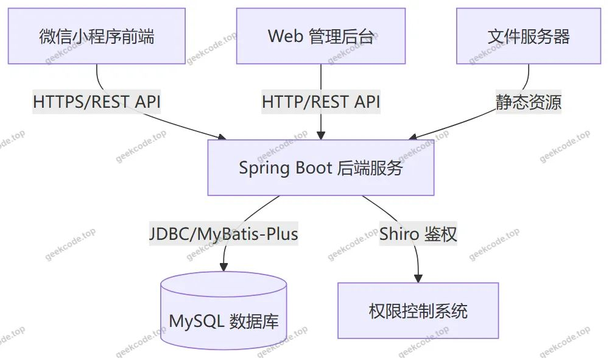</a>

<h2>功能模块</h2>

根据源码Controller列表、路由配置及截图功能，系统主要划分为以下两大模块：

<h3>1. 微信小程序用户端</h3>

小程序面向普通用户（学生、教师、管理员），提供移动端的便捷操作体验。

<ul>
<li><strong>基础服务</strong>：登录、注册、忘记密码、个人信息修改、个人中心首页。</li>
<li><strong>资讯与公告</strong>：查看新闻公告列表及详情。</li>
<li><strong>学习与任务</strong>：</li>
<li><strong>任务信息</strong>：浏览任务列表、查看任务详情。</li>
<li><strong>报名信息</strong>：查看报名列表及详情。</li>
<li><strong>每日打卡</strong>：查看打卡列表及详情，支持日常签到记录。</li>
<li><strong>任务排名</strong>：查看任务完成情况的排名列表及详情。</li>
<li><strong>学习资料</strong>：教师可查看资料列表与详情，并发表评论（对应后台Discussxuexiziliao）。</li>
<li><strong>交流与互动</strong>：</li>
<li><strong>交流信息</strong>：查看交流列表及详情。</li>
<li><strong>回复信息</strong>：查看对交流信息的回复列表及详情。</li>
<li><strong>人员管理视图</strong>：</li>
<li><strong>学生列表/详情</strong>：教师或管理员视角查看学生信息。</li>
<li><strong>教师列表/详情</strong>：查看教师信息。</li>
<li><strong>积极分子列表/详情</strong>：查看入党积极分子状态。</li>
<li><strong>党员信息列表/详情</strong>：查看正式党员基本信息。</li>
</ul>
<h3>2. Web 后台管理端</h3>

后台主要供管理员进行系统配置和数据维护，基于路由 <code>/dangyuanxinxi</code>, <code>/news</code> 等推断出以下管理模块：

<ul>
<li><strong>党员信息管理</strong> (<code>/dangyuanxinxi</code>)：增删改查党员基本档案。</li>
<li><strong>新闻公告管理</strong> (<code>/news</code>)：发布和管理系统通知、新闻内容。</li>
<li><strong>回复信息管理</strong> (<code>/huifuxinxi</code>)：审核或管理用户对交流内容的回复。</li>
<li><strong>用户管理</strong>：</li>
<li><strong>学生管理</strong> (<code>/xuesheng</code>)：维护学生账号及信息。</li>
<li><strong>教师管理</strong> (<code>/jiaoshi</code>)：维护教师账号及信息。</li>
<li><strong>积极分子管理</strong> (<code>/jijifenzi</code>)：管理入党积极分子名单。</li>
<li><strong>学习资源管理</strong>：</li>
<li><strong>学习资料管理</strong> (<code>/xuexiziliao</code>)：上传和管理学习文档。</li>
<li><strong>资料评论管理</strong> (<code>/discussxuexiziliao</code>)：管理用户对资料的评论。</li>
<li><strong>任务与活动管理</strong>：</li>
<li><strong>任务信息管理</strong> (<code>/renwuxinxi</code>)：创建和编辑学习任务。</li>
<li><strong>任务排名管理</strong> (<code>/renwupaiming</code>)：监控和统计任务完成情况。</li>
<li><strong>报名信息管理</strong> (<code>/baomingxinxi</code>)：处理用户的活动报名申请。</li>
<li><strong>每日打卡管理</strong> (<code>/meiridaka</code>)：查看和管理打卡记录。</li>
<li><strong>社区与论坛</strong>：</li>
<li><strong>论坛管理</strong> (<code>/forum</code>)：管理帖子内容。</li>
<li><strong>交流信息管理</strong> (<code>/jiaoliuxinxi</code>)：管理用户之间的交流留言。</li>
<li><strong>系统配置</strong> (<code>/config</code>)：设置系统参数。</li>
</ul>
<h2>用户角色与权限</h2>

系统依据业务逻辑划分了不同角色，各角色在小程序端和Web后台拥有不同的权限范围。

<h3>1. 管理员 (Admin)</h3>
<ul>
<li><strong>Web后台</strong>：拥有最高权限，可访问所有路由模块。负责系统配置、用户（学生/教师）账号管理、新闻发布、学习资料上传、任务创建、审核报名、查看全局数据统计及评论/回复的管理。</li>
<li><strong>小程序端</strong>：具备查看所有信息的权限，可能包括特殊的管理视图（如截图中的“小程序-管理端-教师列表”暗示管理员可在移动端查看部分管理数据）。</li>
</ul>
<h3>2. 教师 (Teacher)</h3>
<ul>
<li><strong>Web后台</strong>：根据路由结构推测，教师可能无独立后台登录入口，或其权限被整合在特定模块中。若存在教师后台，通常限于管理所教班级或特定任务。</li>
<li><strong>小程序端</strong>：</li>
<li><strong>查看与管理</strong>：可查看“学生列表”、“党员信息”、“积极分子”等人员数据。</li>
<li><strong>学习内容</strong>：查看“学习资料”并进行评论。</li>
<li><strong>任务监督</strong>：查看“任务排名”以评估学生表现。</li>
<li><strong>互动</strong>：参与“交流信息”和“回复信息”。</li>
</ul>
<h3>3. 学生/党员 (Student/Party Member)</h3>
<ul>
<li><strong>Web后台</strong>：通常不直接登录Web后台，或通过受限入口查看个人数据。</li>
<li><strong>小程序端</strong>：</li>
<li><strong>个人事务</strong>：修改个人信息、查看“我的”页面。</li>
<li><strong>学习任务</strong>：查看“任务信息”、“学习资料”、“每日打卡”。</li>
<li><strong>活动参与</strong>：提交“报名信息”，查看“任务排名”。</li>
<li><strong>社交互动</strong>：发布“交流信息”，查看他人发布的“新闻公告”及“回复信息”。</li>
</ul>
<h2>项目特色与创新点</h2>
<ol>
<li><strong>多端协同管理</strong>：实现了Web端集中式管理与移动端便捷式操作的结合。管理员可通过Web后台高效批量处理数据，而教师和学生在移动端即可完成打卡、查看任务和互动，提升了系统的可用性和实时性。</li>
<li><strong>全流程党建服务闭环</strong>：涵盖了从“入党积极分子”到“正式党员”的身份管理，从“理论学习资料”到“实践任务报名”的教育过程，再到“每日打卡”的行为监督，形成了完整的党员培养与服务链条。</li>
<li><strong>互动式学习机制</strong>：引入了“学习资料评论”、“论坛”、“交流信息”及“回复”功能，打破了单向灌输的传统模式，增强了党员之间、师生之间的思想交流与反馈机制。</li>
<li><strong>量化考核体系</strong>：通过“任务排名”和“每日打卡”功能，将抽象的学习成果转化为可视化的数据指标，为党组织评价党员表现提供了客观依据。</li>
</ol>
<h2>部署环境</h2>

为确保系统正常运行，需准备以下软硬件环境：

<strong>硬件要求：</strong>

<ul>
<li>CPU: Intel Core i5 及以上或同等性能处理器</li>
<li>内存: 8GB 及以上</li>
<li>硬盘: 500GB 以上可用空间</li>
</ul>

<strong>软件环境：</strong>

<ol>
<li><strong>操作系统</strong>: Windows 10/11, Linux (CentOS/Ubuntu) 或 macOS。</li>
<li><strong>Java运行环境</strong>: JDK 1.8 或更高版本。</li>
<li><strong>数据库</strong>: MySQL 5.7 或 8.0 版本，需安装 Navicat 或其他客户端工具用于导入SQL脚本。</li>
<li><strong>后端构建工具</strong>: Maven 3.6+ 用于依赖管理和项目打包。</li>
<li><strong>前端开发工具</strong>:</li>
</ol>
<ul>
<li><strong>Web后台</strong>: Node.js (LTS版本)，npm/yarn包管理器，VS Code 编辑器。</li>
<li><strong>小程序端</strong>: 微信开发者工具 (WeChat DevTools)。</li>
</ul>
<ol start="6">
<li><strong>其他组件</strong>: Tomcat (若未使用Spring Boot内置容器) 或直接使用 <code>java -jar</code> 启动 Spring Boot 应用。</li>
</ol>
<h2>五、技术特性</h2>
<ul>
<li>前后端集成部署，前端资源打包至后端 static 目录</li>
<li>使用 MyBatis-Plus 简化数据访问层开发</li>
<li>集成 Shiro 权限框架实现角色权限控制</li>
</ul>
<h2>六、功能模块截图</h2>
<h3>微信小程序用户端</h3>

<figure><figcaption>小程序-报名信息列表</figcaption></figure>
<figure><figcaption>小程序-报名信息详情</figcaption></figure>
<figure><figcaption>小程序-登录</figcaption></figure>
<figure><a href="https://geekcode.top/archives/%E5%85%9A%E5%91%98%E4%B9%8B%E5%AE%B6%E6%9C%8D%E5%8A%A1%E7%B3%BB%E7%BB%9F%E5%B0%8F%E7%A8%8B%E5%BA%8F-%E8%AE%BA%E6%96%87?utm_source=github" title="查看完整源码">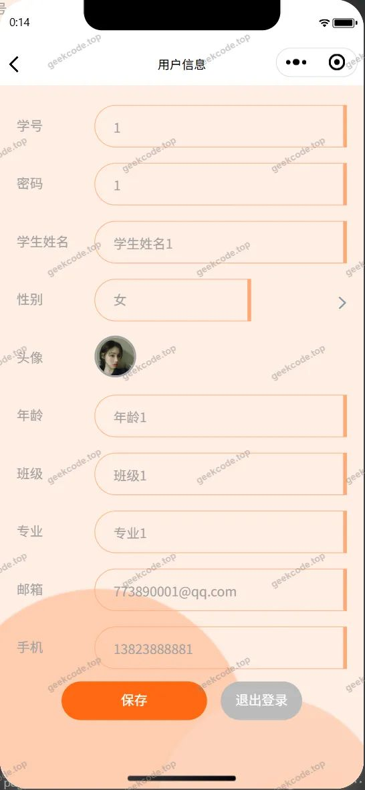</a><figcaption>小程序-个人信息</figcaption></figure>
<figure><figcaption>小程序-回复信息列表</figcaption></figure>
<figure><a href="https://geekcode.top/archives/%E5%85%9A%E5%91%98%E4%B9%8B%E5%AE%B6%E6%9C%8D%E5%8A%A1%E7%B3%BB%E7%BB%9F%E5%B0%8F%E7%A8%8B%E5%BA%8F-%E8%AE%BA%E6%96%87?utm_source=github" title="查看完整源码">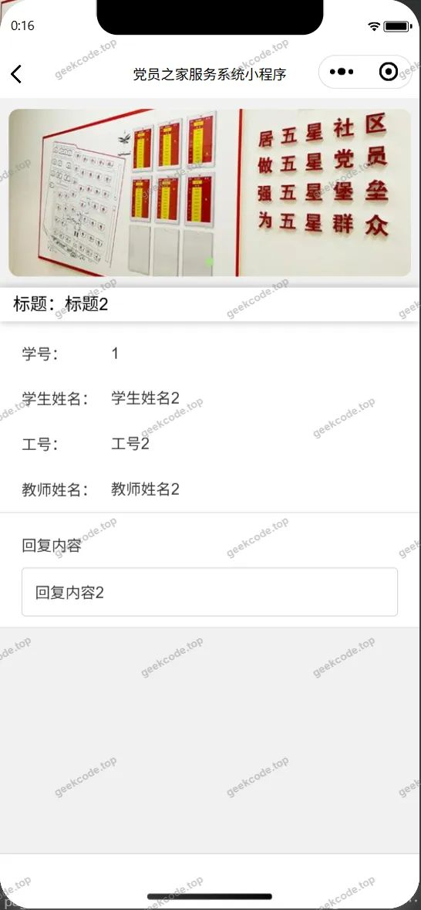</a><figcaption>小程序-回复信息详情</figcaption></figure>
<figure><figcaption>小程序-交流信息列表</figcaption></figure>
<figure><figcaption>小程序-交流信息详情</figcaption></figure>
<figure><figcaption>小程序-每日打卡列表</figcaption></figure>
<figure><a href="https://geekcode.top/archives/%E5%85%9A%E5%91%98%E4%B9%8B%E5%AE%B6%E6%9C%8D%E5%8A%A1%E7%B3%BB%E7%BB%9F%E5%B0%8F%E7%A8%8B%E5%BA%8F-%E8%AE%BA%E6%96%87?utm_source=github" title="查看完整源码">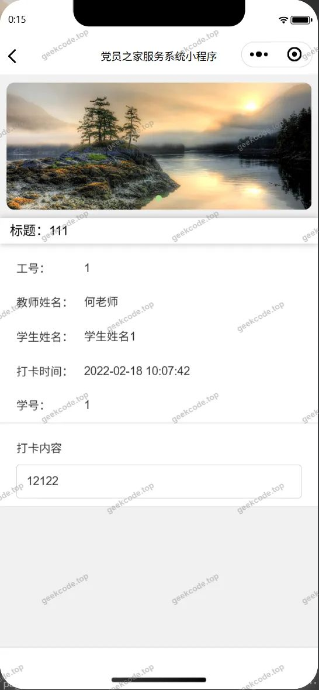</a><figcaption>小程序-每日打卡详情</figcaption></figure>
<figure><figcaption>小程序-任务排名列表</figcaption></figure>
<figure><a href="https://geekcode.top/archives/%E5%85%9A%E5%91%98%E4%B9%8B%E5%AE%B6%E6%9C%8D%E5%8A%A1%E7%B3%BB%E7%BB%9F%E5%B0%8F%E7%A8%8B%E5%BA%8F-%E8%AE%BA%E6%96%87?utm_source=github" title="查看完整源码">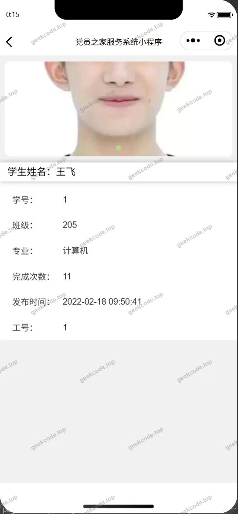</a><figcaption>小程序-任务排名详情</figcaption></figure>
<figure><figcaption>小程序-任务信息列表</figcaption></figure>
<figure><figcaption>小程序-任务信息详情</figcaption></figure>
<figure><figcaption>小程序-首页</figcaption></figure>
<figure><a href="https://geekcode.top/archives/%E5%85%9A%E5%91%98%E4%B9%8B%E5%AE%B6%E6%9C%8D%E5%8A%A1%E7%B3%BB%E7%BB%9F%E5%B0%8F%E7%A8%8B%E5%BA%8F-%E8%AE%BA%E6%96%87?utm_source=github" title="查看完整源码">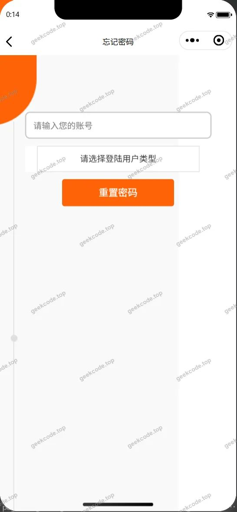</a><figcaption>小程序-忘记密码</figcaption></figure>
<figure><a href="https://geekcode.top/archives/%E5%85%9A%E5%91%98%E4%B9%8B%E5%AE%B6%E6%9C%8D%E5%8A%A1%E7%B3%BB%E7%BB%9F%E5%B0%8F%E7%A8%8B%E5%BA%8F-%E8%AE%BA%E6%96%87?utm_source=github" title="查看完整源码">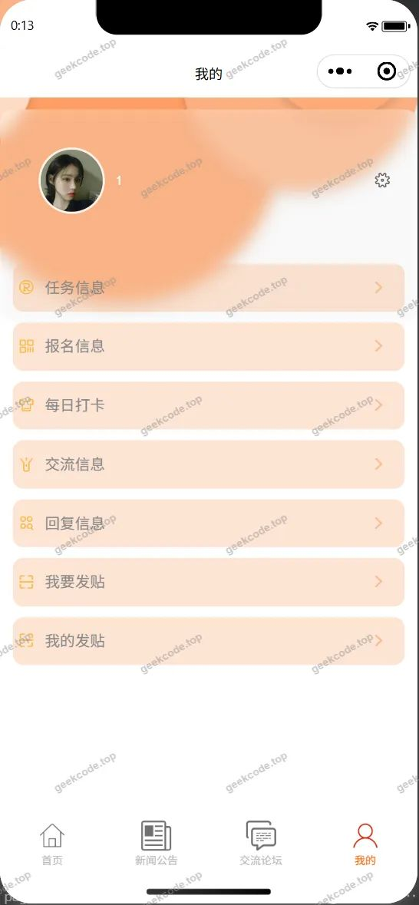</a><figcaption>小程序-我的</figcaption></figure>
<figure><figcaption>小程序-新闻公告</figcaption></figure>
<figure><a href="https://geekcode.top/archives/%E5%85%9A%E5%91%98%E4%B9%8B%E5%AE%B6%E6%9C%8D%E5%8A%A1%E7%B3%BB%E7%BB%9F%E5%B0%8F%E7%A8%8B%E5%BA%8F-%E8%AE%BA%E6%96%87?utm_source=github" title="查看完整源码">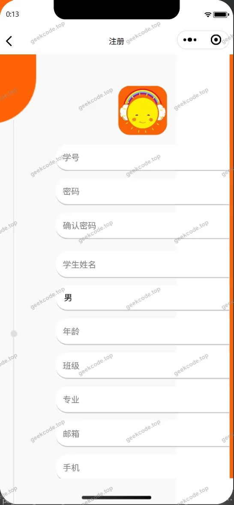</a><figcaption>小程序-注册</figcaption></figure>

<h3>微信小程序管理端</h3>

<figure><figcaption>小程序-管理端-教师列表</figcaption></figure>
<figure><figcaption>小程序-管理端-教师详情</figcaption></figure>

<h3>微信小程序教师端</h3>

<figure><figcaption>小程序-教师-党员信息列表</figcaption></figure>
<figure><a href="https://geekcode.top/archives/%E5%85%9A%E5%91%98%E4%B9%8B%E5%AE%B6%E6%9C%8D%E5%8A%A1%E7%B3%BB%E7%BB%9F%E5%B0%8F%E7%A8%8B%E5%BA%8F-%E8%AE%BA%E6%96%87?utm_source=github" title="查看完整源码">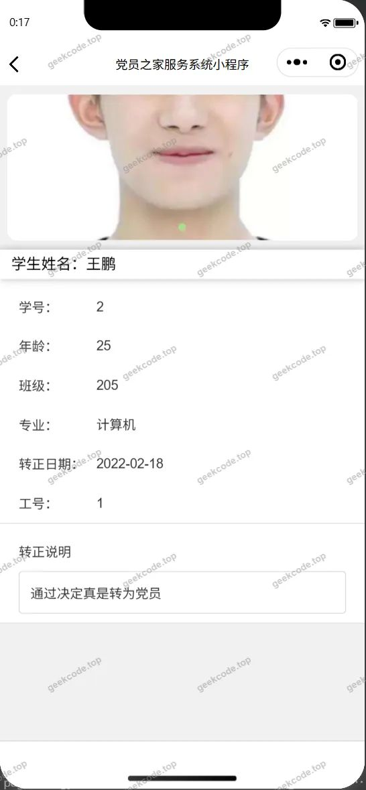</a><figcaption>小程序-教师-党员信息详情</figcaption></figure>
<figure><figcaption>小程序-教师-积极分子列表</figcaption></figure>
<figure><a href="https://geekcode.top/archives/%E5%85%9A%E5%91%98%E4%B9%8B%E5%AE%B6%E6%9C%8D%E5%8A%A1%E7%B3%BB%E7%BB%9F%E5%B0%8F%E7%A8%8B%E5%BA%8F-%E8%AE%BA%E6%96%87?utm_source=github" title="查看完整源码">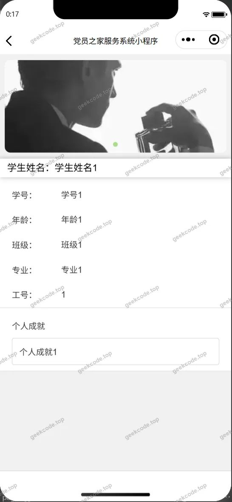</a><figcaption>小程序-教师-积极分子详情</figcaption></figure>
<figure><figcaption>小程序-教师-学生列表</figcaption></figure>
<figure><figcaption>小程序-教师-学生详情</figcaption></figure>
<figure><figcaption>小程序-教师-学习资料列表</figcaption></figure>
<figure><figcaption>小程序-教师-学习资料详情</figcaption></figure>

<h3>后台管理端</h3>
<h4>后台-党员信息</h4>

<a href="https://geekcode.top/archives/%E5%85%9A%E5%91%98%E4%B9%8B%E5%AE%B6%E6%9C%8D%E5%8A%A1%E7%B3%BB%E7%BB%9F%E5%B0%8F%E7%A8%8B%E5%BA%8F-%E8%AE%BA%E6%96%87?utm_source=github" title="查看完整源码">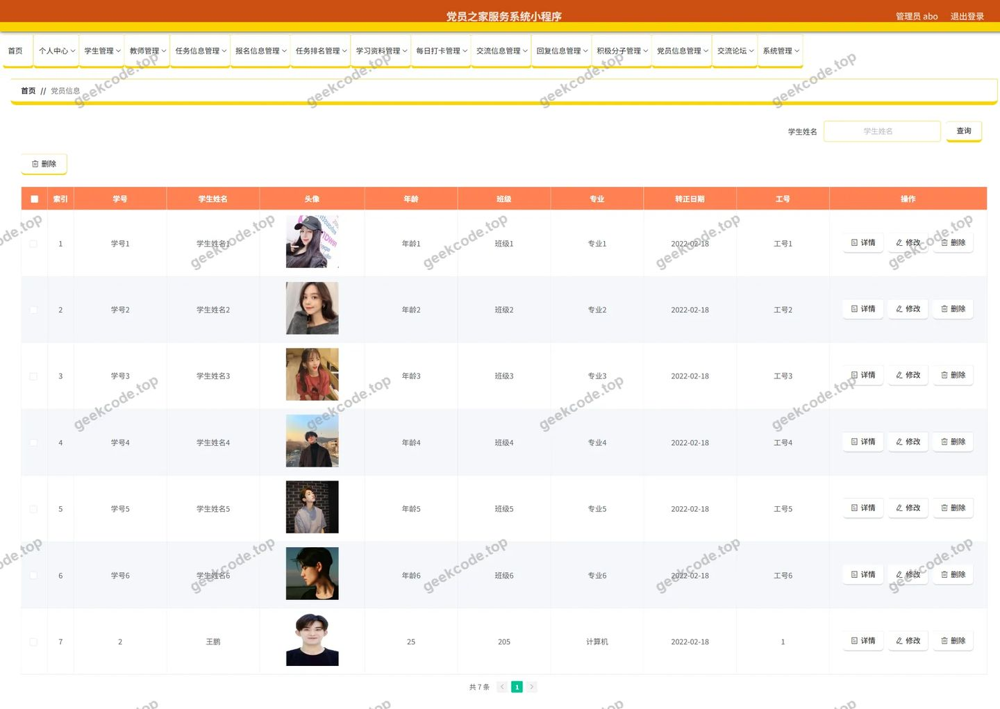</a>

<h4>后台-登录页</h4>

<h4>后台-回复信息</h4>

<a href="https://geekcode.top/archives/%E5%85%9A%E5%91%98%E4%B9%8B%E5%AE%B6%E6%9C%8D%E5%8A%A1%E7%B3%BB%E7%BB%9F%E5%B0%8F%E7%A8%8B%E5%BA%8F-%E8%AE%BA%E6%96%87?utm_source=github" title="查看完整源码">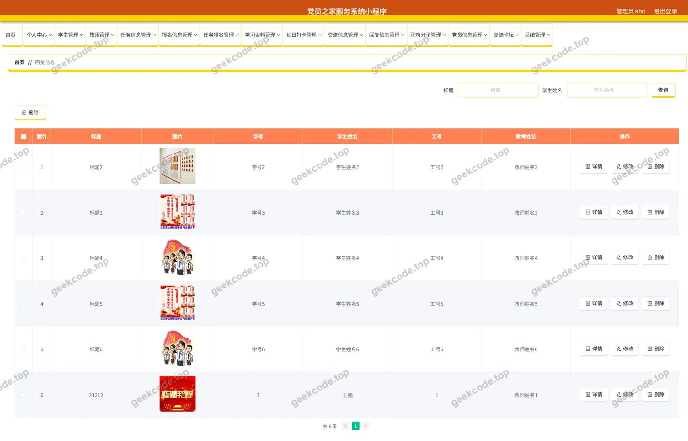</a>

<h4>后台-教师</h4>

<a href="https://geekcode.top/archives/%E5%85%9A%E5%91%98%E4%B9%8B%E5%AE%B6%E6%9C%8D%E5%8A%A1%E7%B3%BB%E7%BB%9F%E5%B0%8F%E7%A8%8B%E5%BA%8F-%E8%AE%BA%E6%96%87?utm_source=github" title="查看完整源码">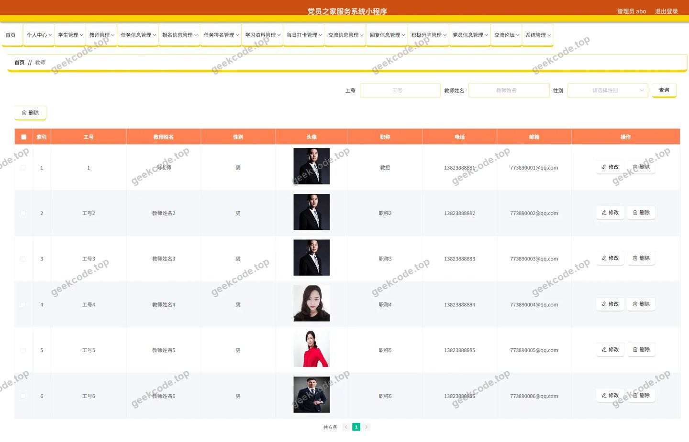</a>

<h4>后台首页</h4>

<a href="https://geekcode.top/archives/%E5%85%9A%E5%91%98%E4%B9%8B%E5%AE%B6%E6%9C%8D%E5%8A%A1%E7%B3%BB%E7%BB%9F%E5%B0%8F%E7%A8%8B%E5%BA%8F-%E8%AE%BA%E6%96%87?utm_source=github" title="查看完整源码">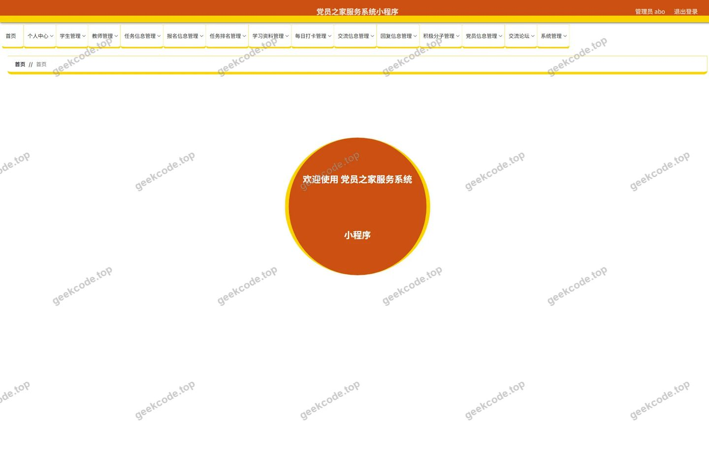</a>

<h4>后台-新闻公告</h4>

<a href="https://geekcode.top/archives/%E5%85%9A%E5%91%98%E4%B9%8B%E5%AE%B6%E6%9C%8D%E5%8A%A1%E7%B3%BB%E7%BB%9F%E5%B0%8F%E7%A8%8B%E5%BA%8F-%E8%AE%BA%E6%96%87?utm_source=github" title="查看完整源码">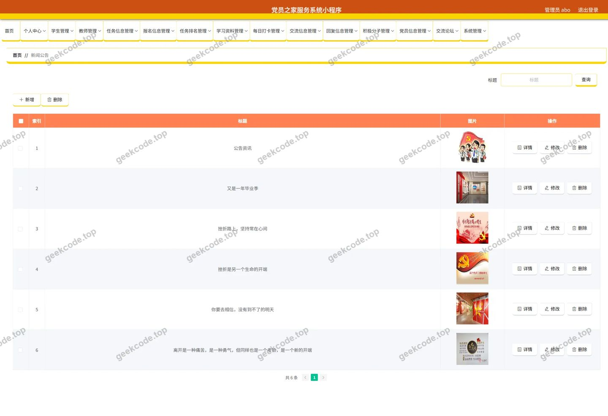</a>

<h4>后台-学生</h4>

<a href="https://geekcode.top/archives/%E5%85%9A%E5%91%98%E4%B9%8B%E5%AE%B6%E6%9C%8D%E5%8A%A1%E7%B3%BB%E7%BB%9F%E5%B0%8F%E7%A8%8B%E5%BA%8F-%E8%AE%BA%E6%96%87?utm_source=github" title="查看完整源码">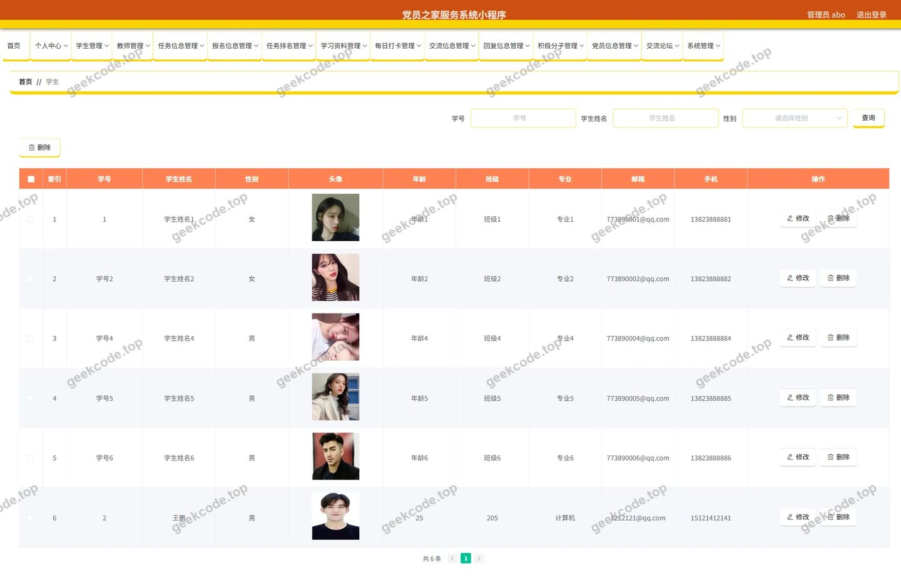</a>

<h4>后台-学习资料评论</h4>

<a href="https://geekcode.top/archives/%E5%85%9A%E5%91%98%E4%B9%8B%E5%AE%B6%E6%9C%8D%E5%8A%A1%E7%B3%BB%E7%BB%9F%E5%B0%8F%E7%A8%8B%E5%BA%8F-%E8%AE%BA%E6%96%87?utm_source=github" title="查看完整源码">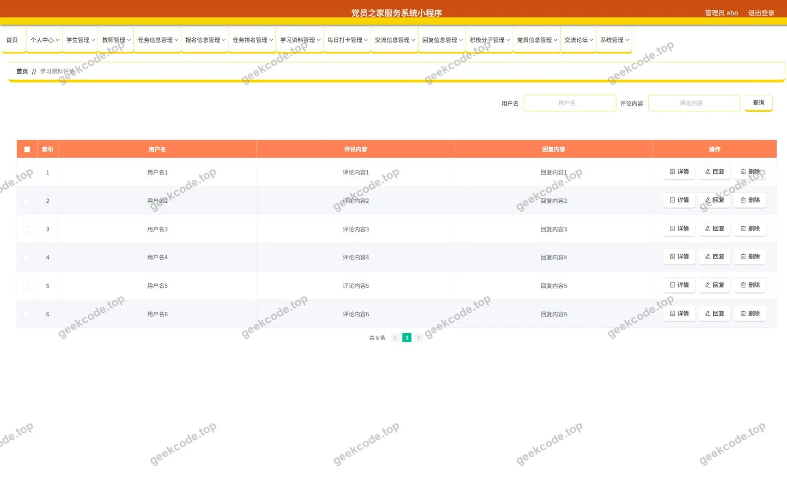</a>

---

## 获取完整源码

| 项目 | 说明 |
| --- | --- |
| 项目名 | 党员之家服务系统小程序--论文 |
| 运行截图 | 本文 38 张（站点带水印原图，仓库 `images/` 目录） |
| 完整源码 | [https://geekcode.top/archives/%E5%85%9A%E5%91%98%E4%B9%8B%E5%AE%B6%E6%9C%8D%E5%8A%A1%E7%B3%BB%E7%BB%9F%E5%B0%8F%E7%A8%8B%E5%BA%8F-%E8%AE%BA%E6%96%87?utm_source=github](https://geekcode.top/archives/%E5%85%9A%E5%91%98%E4%B9%8B%E5%AE%B6%E6%9C%8D%E5%8A%A1%E7%B3%BB%E7%BB%9F%E5%B0%8F%E7%A8%8B%E5%BA%8F-%E8%AE%BA%E6%96%87?utm_source=github) |
| 咨询微信 | **ir9372**（备注：jingpin-yuanma） |
| 更多项目 | [极客代码 geekcode.top](https://geekcode.top/?utm_source=github) |

> 需要源码、部署、改配置、跑不起来等问题，加微信 ir9372 沟通，说明项目名即可。
